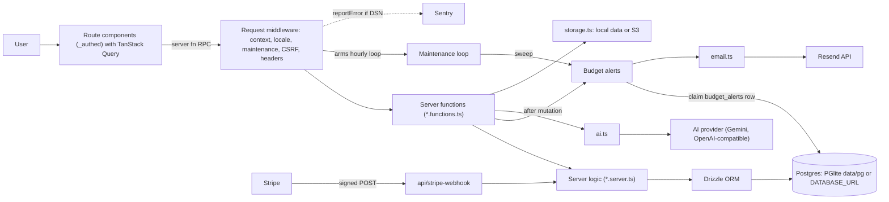

# Finance Tracker — take-home task

A personal finance tracker built with TanStack Start, Drizzle (Postgres via
embedded PGlite), TanStack Query, Tailwind/shadcn UI and Paraglide i18n.

**Your task is in [TASK.md](TASK.md).**

## Getting started

Requirements: Node.js 22+ and pnpm 10 (`corepack enable` will pick up the
pinned version). Use `pnpm`, not `npm`.

```bash
pnpm install
pnpm exec playwright install chromium   # for E2E tests
pnpm run dev                            # http://127.0.0.1:3000
```

No `.env` is needed for local development: the database is an embedded
PGlite instance under `./data/pg`. See `.env.example` for optional settings
(set `AI_FAKE=1` if you don't want to configure an AI provider).

`pnpm run check` runs typecheck, lint, unit tests and E2E tests together.
Project conventions are documented in [CLAUDE.md](CLAUDE.md) (identical to
[AGENTS.md](AGENTS.md)).

## System flow

Route components call server functions over RPC through TanStack Query. The
server functions validate input and delegate to server-only logic, which reads
and writes Postgres through Drizzle. Budget alerts run after a mutation that
can raise spending, and again in the hourly maintenance sweep. Each claims one
`budget_alerts` row per budget per month before sending the email.



For the full interactive diagram, with source references for each component
and notes on budget spend rules, plan limits and receipt scanning, open
[docs/architecture/system-flow/system-flow.html](docs/architecture/system-flow/system-flow.html)
in a browser.

Design documents: [budgets spec, with tickets in §7](docs/specs/monthly-budgets.md)
and [ADR 0001](docs/adr/0001-budgets-in-server-functions.md).

## How we'd like you to work

You're welcome — encouraged — to use AI coding agents. Treat the task as
you would a real feature in an unfamiliar codebase.

In the interview we'll ask you to:

- walk us through your workflow and your conversations with the agent(s);
- explain the design of your solution and how it fits the existing code;
- demo the feature running locally.

Please keep your agent session history and any agent configuration you
used so you can show them. Note that `.gitignore` excludes `.claude/`,
`.agents/`, `.mcp.json` etc. — remove those entries if you'd like to commit
your setup.
