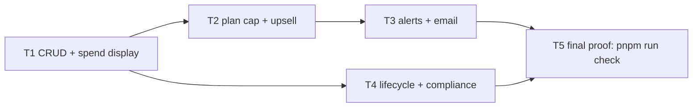

# Monthly category budgets

**Status:** Draft — approved decisions from grilling session 2026-11-06.
**Source:** `TASK.md` (User Story, Priority High, tags budgets, pro-upsell).
**ADR:** [0001 — Budgets live in TanStack Start server functions](../adr/0001-budgets-in-server-functions.md).
**Branch:** `feat/monthly-budgets`.

## 1. Problem statement

Users can see what they spent per category (dashboard, transactions list) but
have no way to plan against it. There is no notion of a limit, no "how much is
left this month", and no signal when spending runs past what the user intended.
Budgets are also a Pro upsell lever: the free plan is capped, Pro is unlimited.

**User story (TASK.md):** As a user, I want to set a monthly spending limit per
category so that I can control my spending instead of just tracking it.

**Affected people:** every signed-in user (feature), free-plan users (cap and
upsell), the compliance surface (export / deletion must include the new data).

**Current cost:** spending control happens outside the product (spreadsheets,
mental math); no retention or upgrade hook exists around planning.

### Goals

- A "Budgets" page where a user adds, edits (limit) and removes one budget per
  category, and sees limit / spent this month / left / over-budget per budget.
- Spend roll-up over the category subtree, expenses only, current UTC month.
- One email per budget per month when spending goes over the limit.
- Free plan: up to 3 budgets (configurable), Pro: unlimited; upsell at the cap.
- Budgets are user data: exported, deleted with the account, ownership-scoped.

### Non-goals (explicitly out of scope)

- Past-month history or month navigation (the page shows the current month only).
- Per-user timezone; the month is the UTC calendar month.
- FX conversion across currencies; a budget counts only one currency.
- A dashboard widget or any dashboard change.
- Budget rollover (unspent carry-over) or per-month limit overrides.
- Showing budget usage on the `/billing` page (optional follow-up, not required).

## 2. Solution

Budgets follow the project's established server-function shape (ADR 0001): a
`budgets` table and a `budget_alerts` ledger in Drizzle, domain logic in
`src/server/budgets.server.ts` (spend aggregation over the category subtree,
alert evaluation with an idempotent claim), `createServerFn` wrappers in
`src/server/budgets.functions.ts` (zod `inputValidator`, `requireUserId`,
ownership scoped in the same query), and a `/_authed/budgets` route built with
TanStack Query. Entitlements gain `maxBudgets`, mirrored on
`checkAccountLimit`. Over-budget alerts are evaluated inline after every
transaction-mutating path that can raise spend and by the hourly maintenance
loop as a safety net; delivery goes through `sendEmail()` so TEST_MODE captures
it. Compliance touchpoints (export zip, hard delete, category delete cascade,
`OWNED_TABLES`) are extended in place.

## 3. Acceptance criteria

Each criterion maps to a TASK.md bullet: B1 nav page, B2 add/change/remove,
B3 limit/spent/left/over display, B4 parent includes subcategories, B5 only
spending counts, B6 monthly reset, B7 one email per budget per month, B8 free 3
/ Pro unlimited, N1 must not break existing functionality, N2 compliance.

### Navigation and page (B1)

- **AC-1 (B1)** Given a signed-in user, when the sidebar renders, then a link
  with accessible name "Budgets" appears immediately after "Categories" and
  navigates to `/budgets`; existing links (`tests/e2e/sidebar.spec.ts`) are
  unchanged.
- **AC-2 (B1)** Given a user with no budgets and at least one account, when
  `/budgets` loads, then an empty state with an "Add budget" action is shown.
- **AC-3 (B1, D8)** Given a user with no accounts, when `/budgets` loads, then
  the page shows an empty state explaining a currency comes from an account and
  links to `/accounts`; the add action is not offered.

### Create, update, remove (B2)

- **AC-4 (B2)** Given a user with categories and an account, when they open
  "Add budget", pick a category (hierarchy shown with indentation), a currency
  (distinct currencies of their accounts, default first account's) and enter a
  limit, then a budget row is created with `limit_minor` parsed by
  `parseAmountToMinor` and the card appears without a page reload.
- **AC-5 (B2)** Given a budget exists for category C, when the user tries to
  add another budget for C, then `createBudget` returns `{ error }` (unique
  `(user_id, category_id)`) and the dialog shows the error; the category
  select already excludes categories that have a budget.
- **AC-6 (B2)** Given the add dialog, when the limit is empty, non-numeric,
  zero, negative or above 2147483647 minor units, then a validation message is
  shown and nothing is submitted; server-side the zod schema rejects the same
  inputs.
- **AC-7 (B2)** Given an uncategorized transaction, then it can never be
  budgeted: the category select offers only the user's categories; there is no
  "Uncategorized" option.
- **AC-8 (B2, D4)** Given an existing budget, when the user edits it, then only
  the limit is editable (category and currency are read-only in the dialog),
  `updateBudget` persists `limit_minor` and `updated_at`, and the card
  re-renders with the new limit, left and over-state for the current month.
- **AC-9 (B2)** Given an existing budget, when the user confirms "Remove" in
  the AlertDialog, then the budget and its `budget_alerts` rows are deleted and
  the card disappears.
- **AC-10 (B2, N2)** Given budget id X owned by user A, when user B calls
  `updateBudget` or `deleteBudget` with X, then the result is `{ error:
  "Budget not found" }` and no row changes (single query `WHERE id = ? AND
  user_id = ?`).

### Display (B3)

- **AC-11 (B3)** Given a budget with limit L and current-month spend S <= L,
  then the card shows the category (`CategoryBadge`), L, S and "Left" = L - S,
  all formatted with `formatMoney(minor, currency)`, and a progress bar at
  `min(100, S / L * 100)` percent with `role="progressbar"`.
- **AC-12 (B3, D12)** Given S > L (strictly), then the card shows "Over by
  (S - L)", the progress bar is red at 100 percent and an "Over budget" badge
  (`Badge variant="destructive"`) is visible. Given S == L, no over state.
- **AC-13 (B3, D8)** The page states that spending in other currencies is not
  counted.

### Spend semantics (B4, B5, B6)

- **AC-14 (B4, D6)** Given budget on parent P with child C1 and grandchild C2
  (under C1), when expenses exist on P, C1 and C2, then S equals the sum over
  all three. Descendants at any depth count; a cycle in `parent_id` does not
  hang the walk (visited set).
- **AC-15 (B5, D5)** Given expenses (negative `amount_minor`) and income or
  refunds (positive `amount_minor`) in the category subtree, then S equals the
  sum of `ABS(amount_minor)` over negative rows only; positive rows never reduce
  S.
- **AC-16 (B6, D9)** Given month M = 'YYYY-MM', then only transactions with
  `date >= first day of M` and `date < first day of M+1` count; a transaction
  dated the last day of M-1 or the first day of M+1 does not. Every server
  function and `computeBudgetSpend` accept an explicit `month` (default:
  current UTC month) so this is unit-testable.
- **AC-17 (D8)** Given a budget in currency X, then only transactions whose
  account currency equals X count (`COALESCE(accounts.currency, 'PLN')`, the
  column default); transactions on a Y-currency account are ignored.
- **AC-18 (D7)** A categorized expense counts whole toward
  `transactions.category_id`. An uncategorized expense with a receipt counts
  each receipt item's `total_price_minor` toward that item's category (same
  split as the dashboard); uncategorized items count toward no budget.
- **AC-19 (D10)** Given budgets on both P and its child C1, then an expense on
  C1 counts toward both budgets.

### Alerts and email (B7)

- **AC-20 (B7, D12, D13)** Given a verified user with a budget whose spend
  crosses strictly above the limit through a manual transaction create/update
  or delete, a CSV import commit, a receipt-scan transaction creation, a budget
  create, or a limit update, then within the same request (fire-and-forget,
  after the mutation succeeded) `evaluateBudgetAlerts(userId, month)` runs; an
  evaluation error is logged and never fails or delays the mutation's result.
- **AC-21 (B7, D14)** Given the first time a budget is over in month M, then
  exactly one `budget_alerts` row `(budget_id, M)` is claimed via `INSERT ...
  ON CONFLICT (budget_id, month) DO NOTHING`, one email is sent through
  `sendEmail`, and the row ends `status = 'sent'` with `sent_at` set.
- **AC-22 (B7, D15)** Given an alert already exists for `(budget, M)`, when
  spend rises further, the limit is raised and exceeded again, or the sweep
  runs, then no second email is sent in M.
- **AC-23 (B7, D15)** Given a budget not yet alerted in M with spend S, when
  the limit is lowered below S, then one alert is sent (counts as going over).
- **AC-24 (B7, D15)** Given a backdated transaction that pushes month M-1 over
  its limit, then nothing is sent; only the current UTC month is evaluated.
- **AC-25 (B7, D14)** Given a `pending` alert row for the current month whose
  send failed, when the sweep runs, then delivery is retried; on success the
  row becomes `sent`.
- **AC-26 (B7, D16)** Given a user with `email` null or `email_verified_at`
  null, when a budget goes over, then the row is claimed and set to
  `status = 'skipped'` (`sent_at` null) and no email is sent; the row never
  fires later in that month, even after the user verifies.
- **AC-27 (B7, D17)** The email uses `m.email_budget_exceeded_subject()` and
  `m.email_budget_exceeded_body({...})` with category name, limit, spent,
  over-by amount (each via `formatMoney`), month and a link
  `${env.email.baseUrl}/budgets`; in TEST_MODE it is readable from
  `/test-emails?to=<email>`.
- **AC-28 (B7, D13)** The hourly maintenance loop calls
  `runBudgetAlertSweep()` after `runComplianceSweep()`; `POST /test-run-sweep`
  (TEST_MODE only) runs both and returns the merged counts so E2E can trigger
  evaluation deterministically. Categorization rules, recategorize and
  category reassignment are covered by the sweep only (no inline hook).

### Plans (B8)

- **AC-29 (B8, D18)** `entitlementsForPlan("free").maxBudgets ===
  env.billing.freeMaxBudgets` (env `BILLING_FREE_MAX_BUDGETS`, default 3,
  must be a positive integer or `validateEnv` throws);
  `entitlementsForPlan("pro").maxBudgets === null`.
- **AC-30 (B8)** Given a free user with 3 budgets, when `createBudget` is
  called, then it returns `{ error, code: "budget_limit_reached", limit: 3 }`
  and no row is inserted; `checkBudgetLimit` mirrors `checkAccountLimit`.
  The count and insert run in one transaction holding a `FOR UPDATE` lock on
  the user's row (`insertBudgetWithinLimit`), so concurrent creates cannot
  exceed the cap.
- **AC-31 (B8)** Given a free user at the cap, when `/budgets` renders, then
  "3 of 3 budgets" usage is shown, the add action is disabled and an upsell
  linking to `/billing` is shown; below the cap the usage reads "N of 3".
- **AC-32 (B8)** Given a Pro user (`POST /test-set-plan?plan=pro` in E2E), then
  a fourth and later budget can be created and no usage cap text is shown.
- **AC-33 (B8, D18)** Given a user downgraded from Pro with 5 budgets, then all
  5 keep computing spend and alerting; only creating a sixth is blocked.

### Lifecycle and compliance (N1, N2)

- **AC-34 (N2, D19)** Given a category with descendants, some with budgets,
  when `deleteCategory` runs (with or without reassignment target), then the
  `budget_alerts` and `budgets` rows of every deleted category id are deleted
  in the same handler, scoped by `user_id`; budgets are not moved to the
  reassignment target.
- **AC-35 (N2, D20)** `collectUserExport` returns `budgets` and
  `budgetAlerts`; `export.json` contains both and the zip contains
  `budgets.csv` (`id, category, currency, limit, limit_minor, created_at,
  updated_at`).
- **AC-36 (N2, D20)** `hardDeleteUser` deletes `budget_alerts` then `budgets`
  for the user inside the existing transaction, before `categories`.
- **AC-37 (N2, D20)** `OWNED_TABLES` has `budget: schema.budgets`;
  `ownedEntityExists("budget", userId, id)` works.
- **AC-38 (N2)** Log lines in budgets code carry ids and counts only, never
  amounts, limits or category names.
- **AC-39 (N1)** `pnpm run check` passes at the final gate: existing unit and
  E2E suites plus the new ones; `tests/billing.test.ts` entitlement `toEqual`
  assertions are updated for `maxBudgets`.

## 4. Design

### 4.1 Data model (`src/db/schema.ts`, migration `drizzle/0004_*.sql`)

```
pgEnum budget_alert_status: 'pending' | 'sent' | 'skipped'

budgets
  id           text PK (crypto.randomUUID())
  user_id      text NOT NULL FK users.id
  category_id  text NOT NULL FK categories.id
  currency     text NOT NULL            -- ISO 4217 code, matches accounts.currency
  limit_minor  integer NOT NULL         -- minor units, > 0, <= 2147483647
  created_at   timestamptz NOT NULL default now()
  updated_at   timestamptz NOT NULL default now()
  UNIQUE (user_id, category_id)        -- budgets_user_category_uq; also serves
                                        -- the per-user lookup (leading column)

budget_alerts
  id         text PK
  budget_id  text NOT NULL FK budgets.id
  user_id    text NOT NULL FK users.id   -- direct ownership, like receipts
  month      text NOT NULL               -- 'YYYY-MM' (UTC calendar month)
  status     budget_alert_status NOT NULL default 'pending'
  created_at timestamptz NOT NULL default now()
  sent_at    timestamptz NULL
  UNIQUE (budget_id, month)             -- budget_alerts_budget_month_uq (idempotency)
  INDEX (user_id, month)                -- budget_alerts_user_month_idx (pending retry)
```

No cascade clauses, consistent with the rest of the schema; deletions are
explicit (section 4.6). Generated with `pnpm run db:generate` so
`drizzle/meta/_journal.json` gains entry idx 4. `tests/db-migrate.test.ts` does
not pin the migration count (verified).

Status semantics (D16): `pending` = claimed, delivery not yet confirmed;
`sent` = delivered once; `skipped` = claimed but suppressed because the user
had no verified email. A third value is used instead of marking suppressed rows
`sent` because the export and future support tooling must not claim an email
was delivered when it was not, and because the sweep's retry query selects
`status = 'pending'` only, so `skipped` rows are terminal.

### 4.2 Spend aggregation (`budgets.server.ts`)

`computeBudgetSpend(userId, month, budgets, db)` returns `Map<budgetId,
spentMinor>` with one category load and one aggregate query:

1. Load `{ id, parent_id }` of the user's categories; build a `children` map.
2. For each budget, collect the descendant set of `category_id` with a
   `visited` guard (same approach as the ancestry walk in
   `updateCategory`, `src/server/categories.functions.ts:179-201`).
3. One query: `SELECT t.category_id, COALESCE(a.currency,'PLN') AS currency,
   SUM(ABS(t.amount_minor)) FROM transactions t JOIN accounts a ON a.id =
   t.account_id WHERE t.user_id = ? AND t.amount_minor < 0 AND t.category_id IS
   NOT NULL AND t.date >= ? AND t.date < ? GROUP BY 1, 2` (bounds from
   `monthRange(month)`; uses `transactions_user_date_idx`).
4. Per budget: sum the grouped rows whose category is in its descendant set and
   whose currency equals the budget currency.

An in-memory walk is preferred over a recursive CTE because the user's category
tree is small, is already loaded this way elsewhere, and keeps the roll-up
testable without SQL dialect concerns.

Helpers: `currentUtcMonth(now = new Date()): string`, `monthRange(month):
{ start: 'YYYY-MM-01', end: 'YYYY-MM-01' of next month }`, zod `monthSchema =
z.string().regex(/^\d{4}-(0[1-9]|1[0-2])$/)`.

### 4.3 Server function contracts (`budgets.functions.ts`)

Return convention verified in the repo: success returns the created row or
`{ success: true }`; failure returns `{ error: string }` with an optional
`code` and `limit` for plan gates (`src/server/accounts.functions.ts:60-63`,
`src/routes/_authed/accounts.tsx:374-381`). There is no `{ success, data }`
envelope; the contracts below follow the actual convention.

| Function | Method | Input (zod) | Returns |
|---|---|---|---|
| `getBudgets` | GET | `{ month?: monthSchema }` | `{ month, limit: number \| null, plan, budgets: BudgetView[] }` |
| `createBudget` | POST | `{ categoryId: z.string().min(1), currency: z.string().regex(/^[A-Z]{3}$/), limitMinor: z.number().int().positive().max(2147483647), month?: monthSchema }` | `{ id, category_id, currency, limit_minor }` or `{ error }` or `{ error, code: "budget_limit_reached", limit }` |
| `updateBudget` | POST | `{ id: z.string(), limitMinor: same bounds, month?: monthSchema }` | `{ success: true }` or `{ error: "Budget not found" }` |
| `deleteBudget` | POST | `{ id: z.string() }` | `{ success: true }` or `{ error: "Budget not found" }` |

`BudgetView = { id, category_id, category_name, category_color, currency,
limit_minor, spent_minor, remaining_minor (limit - spent, negative when over),
over_budget: boolean, created_at, updated_at }`.

Handler rules: `requireUserId()` first; `createBudget` checks
`ownedEntityExists("category", userId, categoryId)`, then `checkBudgetLimit`,
then inserts and maps a unique violation to `{ error: "A budget already exists
for this category" }`; `updateBudget`/`deleteBudget` filter `id AND user_id` in
the write itself and report not found when zero rows changed. `deleteBudget`
deletes `budget_alerts` for the budget first. `createBudget` and
`updateBudget` end with `void evaluateBudgetAlerts(userId, month).catch(log)`.
Currencies for the picker come from the existing `getAccounts` in the route
(distinct `currency`, null treated as `PLN`), so `getBudgets` stays focused.

### 4.4 Alert evaluation and idempotency (`budgets.server.ts`)

```
evaluateBudgetAlerts(userId, month = currentUtcMonth(), db):
  budgets = SELECT * FROM budgets WHERE user_id = ?
  if none: return { evaluated: 0, claimed: 0, sent: 0, skipped: 0 }
  spend = computeBudgetSpend(userId, month, budgets)
  for b in budgets where spend[b] > b.limit_minor:          -- strict (D12)
    INSERT budget_alerts (id, budget_id, user_id, month, status 'pending')
      ON CONFLICT (budget_id, month) DO NOTHING                -- claim (D14)
  pending = SELECT alerts WHERE user_id = ? AND month = ? AND status = 'pending'
  for each pending alert (covers both new claims and retries):
    user = SELECT email, email_verified_at FROM users WHERE id = ?
    if !user.email || !user.email_verified_at:
      UPDATE status = 'skipped' WHERE id = ? AND status = 'pending'; continue
    marked = UPDATE status = 'sent', sent_at = now()
             WHERE id = ? AND status = 'pending' RETURNING id
    if marked is empty: continue                              -- another caller won
    try sendEmail({ to, subject, text })
    catch: UPDATE status = 'pending', sent_at = null WHERE id = ?; log error
  return counts
```

Marking `sent` before calling `sendEmail` and reverting on failure gives
at-most-once delivery even when two inline evaluations interleave (a shared
`pending` row can be marked by only one of them). A process crash between the
mark and the provider call loses that one email; this trade-off is accepted
because TASK.md makes "max one email per budget per month" the hard
requirement. `runBudgetAlertSweep(now)` selects distinct `user_id` from
`budgets` and calls `evaluateBudgetAlerts` per user for `currentUtcMonth(now)`.

Inline call sites (fire-and-forget, after the write succeeded):
`createTransaction`, `updateTransaction`, `deleteTransaction`
(`src/server/transactions.functions.ts:294, 373, 412`); the transaction insert
in `confirmImport` (`src/server/imports.functions.ts:1078`); the new-transaction
branch of `saveReceiptAndLink` (`src/server/receipts.functions.ts:519`);
`createBudget` and `updateBudget`. Month argument for a transaction mutation is
always `currentUtcMonth()`, never the transaction's date (D15).

### 4.5 Entitlements (`env.ts`, `billing.server.ts`)

- `env.ts`: `BILLING_FREE_MAX_BUDGETS` in `envSchema`;
  `billing.freeMaxBudgets: number` parsed like `freeMaxAccounts`
  (`src/server/env.ts:210-215`), default 3, positive integer or throw.
- `billing.server.ts`: `Entitlements.maxBudgets: number | null`; free =
  `env.billing.freeMaxBudgets`, pro = `null`. `BudgetLimitResult` and
  `checkBudgetLimit(userId, db)` mirror lines 77-109 with code
  `budget_limit_reached`, counting `budgets` by `user_id`.
- `getBudgets` returns `limit` from `getEntitlements` so the page can show
  usage without a second call. `getBillingStatus` is unchanged (optional
  follow-up).

### 4.6 Compliance touchpoints

- `compliance.server.ts` `collectUserExport`: add `budgets` (by `user_id`) and
  `budgetAlerts` (by `user_id`). `buildExportZip`: `export.json` gains
  `budgets` and `budgetAlerts`; add `budgets.csv` with the category name
  resolved from `data.categories`, `limit` via `formatMinor`.
- `hardDeleteUser`: inside the transaction, delete `budget_alerts` then
  `budgets` by `user_id`, placed after the `receipts` delete and before
  `categories`.
- `categories.functions.ts` `deleteCategory`: before the
  `categorization_rules` delete, delete `budget_alerts` whose `budget_id` is in
  `SELECT id FROM budgets WHERE category_id IN (ids) AND user_id = ?`, then
  delete those budgets. Both statements scope by `user_id`.
- `ownership.server.ts`: `budget: schema.budgets` in `OWNED_TABLES`.
- Logging: `getLogger().child({ userId })` with `{ budgetId, month, count }`
  fields only.

### 4.7 UI composition (`src/routes/_authed/budgets.tsx`)

- Route `createFileRoute("/_authed/budgets")`, pattern of
  `src/routes/_authed/categories.tsx`: `useServerFn` wrappers, `useQuery`
  with module-level keys `BUDGETS_QUERY_KEY = ["budgets"] as const`, reuse
  `["categories"]` and `["accounts"]` keys, `useMutation` with
  `invalidateQueries({ queryKey: BUDGETS_QUERY_KEY })` on success, `{ error }`
  checks on results with `code === "budget_limit_reached"` localized via
  Paraglide and other errors shown as returned (existing convention).
- Header: title, description, usage text ("N of L budgets" when `limit !==
  null`), "Add budget" `Button` (disabled at the cap), upsell `Link to="/billing"`
  at the cap, currency note.
- Card per budget: `CategoryBadge`, limit, spent, left or "Over by X",
  `ProgressBar` (new `src/components/ui/progress-bar.tsx`: div with
  `role="progressbar"`, `aria-valuenow/min/max`, `variant: "default" |
  "destructive"`), `Badge variant="destructive"` "Over budget" when over,
  `EditButton` / `DeleteButton` from `action-buttons`.
- Add/edit `Dialog`: category `Select` (tree order with depth prefix, excludes
  budgeted categories when adding, read-only when editing), currency `Select`
  (read-only when editing), limit `Input` parsed with `parseAmountToMinor` and
  pre-filled with `minorToInputValue`; remove via `AlertDialog`.
- Empty states: no accounts (link `/accounts`), no budgets.
- Sidebar: new item `{ to: "/budgets", label: m.nav_budgets() }` inserted
  after the `/categories` item in `src/components/sidebar.tsx:52-71`.

### 4.8 i18n keys (`messages/en.json`, then `pnpm run i18n:compile`)

`nav_budgets`, `budgets_title`, `budgets_description`, `budgets_add`,
`budgets_edit`, `budgets_remove`, `budgets_save`, `budgets_empty_title`,
`budgets_empty_description`, `budgets_no_accounts_title`,
`budgets_no_accounts_description`, `budgets_no_accounts_link`,
`budgets_usage` (`{used}`, `{limit}`), `budgets_limit_reached` (`{limit}`),
`budgets_currency_note`, `budgets_category_label`, `budgets_currency_label`,
`budgets_limit_label`, `budgets_limit_invalid`, `budgets_limit_too_large`,
`budgets_category_required`, `budgets_limit` ("Limit"), `budgets_spent`,
`budgets_left`, `budgets_over_by` (`{amount}`), `budgets_over_badge`,
`budgets_remove_confirm_title`, `budgets_remove_confirm_description`,
`email_budget_exceeded_subject`, `email_budget_exceeded_body` (`{category}`,
`{limit}`, `{spent}`, `{over}`, `{month}`, `{link}`). Reuse existing
`billing_upgrade` for the upsell label and existing generic dialog keys where
present.

### 4.9 Files to add or modify

| Path | Change |
|---|---|
| `src/db/schema.ts` | add `budget_alert_status` enum, `budgets`, `budget_alerts` |
| `drizzle/0004_*.sql`, `drizzle/meta/*` | generated migration for both tables |
| `src/server/budgets.server.ts` | new: month helpers, `computeBudgetSpend`, `listBudgetViews`, `evaluateBudgetAlerts`, `runBudgetAlertSweep` |
| `src/server/budgets.functions.ts` | new: `getBudgets`, `createBudget`, `updateBudget`, `deleteBudget` |
| `src/routes/_authed/budgets.tsx` | new page |
| `src/components/ui/progress-bar.tsx` | new small component |
| `src/components/sidebar.tsx` | nav item after Categories |
| `messages/en.json`, `src/paraglide/*` | keys above, recompiled |
| `src/server/env.ts` | `BILLING_FREE_MAX_BUDGETS` / `freeMaxBudgets` |
| `src/server/billing.server.ts` | `maxBudgets`, `checkBudgetLimit` |
| `src/server/transactions.functions.ts` | inline evaluation after create/update/delete |
| `src/server/imports.functions.ts` | inline evaluation after the batch insert |
| `src/server/receipts.functions.ts` | inline evaluation in `saveReceiptAndLink` new-transaction branch |
| `src/server/maintenance.server.ts` | call `runBudgetAlertSweep` after the compliance sweep |
| `src/routes/test-run-sweep.ts` | run both sweeps, return merged counts |
| `src/server/categories.functions.ts` | budget cascade in `deleteCategory` |
| `src/server/compliance.server.ts` | export + hard delete |
| `src/server/ownership.server.ts` | `budget` in `OWNED_TABLES` |
| `.env.example` | document `BILLING_FREE_MAX_BUDGETS` |
| `tests/budgets.test.ts`, `tests/e2e/budgets*.spec.ts` | new suites (final gate) |
| `tests/billing.test.ts` | `toEqual` entitlement objects gain `maxBudgets` |

## 5. Decision log

| Id | Decision | Rejected alternatives |
|---|---|---|
| D1 | Server functions + `.server.ts` split, route via TanStack Query ([ADR 0001](../adr/0001-budgets-in-server-functions.md)) | NestJS standalone DI in-process; separate NestJS service on Postgres |
| D2 | `budgets` table with unique `(user_id, category_id)`, integer `limit_minor`, ISO `currency` | per-month limit rows; float amounts |
| D3 | `budget_alerts` ledger with unique `(budget_id, month)` | flag column on budgets; in-memory dedupe |
| D4 | Single limit, live spend, current month only; limit edits apply to all months | versioned limits; month navigation |
| D5 | Spent = sum of `ABS(amount_minor)` where `amount_minor < 0` | net of income/refunds |
| D6 | Category subtree at any depth via in-memory walk with cycle guard | direct category only; recursive CTE |
| D7 | Same split as the dashboard: categorized expense counts whole; uncategorized expense with a receipt counts its categorized items | only `transactions.category_id` (original choice; budgets disagreed with the dashboard) |
| D8 | Budget has a currency; only matching-currency accounts count; picker from accounts; empty state without accounts | FX conversion; currency-less budgets |
| D9 | UTC calendar month; explicit `month` parameter everywhere | user timezone; implicit "now" |
| D10 | Overlapping parent/child budgets allowed, expense counts toward both | forbid overlap; count once |
| D11 | Cards with `CategoryBadge`, progress bar, red + "Over budget" badge; Dialog/AlertDialog; sidebar after Categories; Paraglide | table layout; dashboard widget |
| D12 | Over = spent > limit strictly | >= |
| D13 | One `evaluateBudgetAlerts`, inline fire-and-forget after spend-raising paths + hourly sweep + test route | queue/worker; evaluate in the page load |
| D14 | Claim row with `ON CONFLICT DO NOTHING` before sending; mark sent before send, revert on failure | send then record; distributed lock |
| D15 | Current month only; no re-alert after raising the limit; lowering below spend alerts once | re-alert on every crossing; backdated-month alerts |
| D16 | Unverified/no email: claim row with `status = 'skipped'` | mark `sent` (misreports delivery); leave `pending` (would fire after verification) |
| D17 | Paraglide subject/body, link `${env.email.baseUrl}/budgets`, via `sendEmail` | HTML template; direct provider call |
| D18 | `maxBudgets` entitlement; env default 3; `checkBudgetLimit`; downgrade keeps existing; page usage + upsell | UI-only gate; deleting excess budgets on downgrade |
| D19 | `deleteCategory` deletes alerts and budgets of deleted ids; not moved to the reassignment target | move budget to target; block delete |
| D20 | Export (`export.json` + `budgets.csv`), hard-delete order, `OWNED_TABLES`, same-query scoping, id-only logs | post-fetch ownership checks; skip export |

## 6. Known gaps and risks

- As on the dashboard, a receipt's items are not capped at the transaction
  amount; an inaccurate scan can over- or under-count an uncategorized expense.
- Changing a receipt item's category re-evaluates alerts
  (`updateReceiptItems`); deleting a receipt lowers spend, which never alerts.
- UTC month differs from the user's local month near midnight boundaries.
- `accounts.currency` is nullable with default `PLN` (`schema.ts:91`); the spec
  coalesces null to `PLN` (see Open Questions).
- At-most-once delivery: a crash between marking `sent` and the provider call
  loses that month's email for that budget.
- Inline evaluation is fire-and-forget; E2E tests that assert the email must
  poll `/test-emails` or trigger `/test-run-sweep` rather than assume the
  mutation response implies delivery.
- `deleteCategory` runs outside a transaction and deletes the target category
  without a `user_id` filter (`categories.functions.ts:308-311`); the budget
  cascade scopes by `user_id` but does not fix that pre-existing behavior.
- Limit edits are retroactive by design (single limit); past-month views do
  not exist, so there is no visible inconsistency today.
- Server-side Paraglide messages render in the base locale (same as existing
  account emails in `compliance.server.ts`).
- `tests/billing.test.ts:60-69` uses `toEqual` on entitlement objects and must
  be updated; `tests/env.test.ts` may assert `validateEnv` output and should
  be checked at the final gate.

## 7. Tickets

Tracer-bullet vertical slices; each is demoable on its own. Shared files that
force serialization: `src/db/schema.ts` and `drizzle/*` (T1 only),
`messages/en.json` + `src/paraglide/*` (T1, T2, T3), `src/server/budgets.functions.ts`
(T1, T2, T3), `src/server/billing.server.ts` (T2 only). T4 touches disjoint
files and may run in parallel with T2/T3 once T1 is integrated.

### T1 — Budgets CRUD with live spend display

- **Goal:** a user can add, edit and remove budgets and see limit / spent /
  left / over for the current month, end to end.
- **Files:** `src/db/schema.ts`, `drizzle/0004_*.sql`, `drizzle/meta/*`,
  `src/server/budgets.server.ts` (month helpers, `computeBudgetSpend`,
  `listBudgetViews`), `src/server/budgets.functions.ts`,
  `src/routes/_authed/budgets.tsx`, `src/components/ui/progress-bar.tsx`,
  `src/components/sidebar.tsx`, `messages/en.json`, `src/paraglide/*`.
- **Acceptance:** AC-1, AC-2, AC-3, AC-4, AC-5, AC-6, AC-7, AC-8, AC-9,
  AC-10, AC-11, AC-12, AC-13, AC-14 to AC-19. Creates both tables (incl.
  `budget_alerts`) so T3 adds no migration. `getBudgets.limit` is `null` until
  T2 lands.
- **Blocked by:** none.

### T2 — Plan cap and upsell

- **Goal:** free users are capped at `BILLING_FREE_MAX_BUDGETS` (3) with a
  visible usage counter and upsell; Pro is unlimited; downgrade keeps data.
- **Files:** `src/server/env.ts`, `.env.example`, `src/server/billing.server.ts`,
  `src/server/budgets.functions.ts` (`checkBudgetLimit` in `createBudget`,
  `limit` in `getBudgets`), `src/routes/_authed/budgets.tsx` (usage, disabled
  add, upsell), `messages/en.json`, `src/paraglide/*`, `tests/billing.test.ts`
  (`toEqual` update).
- **Acceptance:** AC-29, AC-30, AC-31, AC-32, AC-33, AC-39 (billing test
  update).
- **Blocked by:** T1.

### T3 — Over-budget alerts and email

- **Goal:** one email per budget per month when spend crosses the limit,
  evaluated inline and by the sweep, idempotent, test-triggerable.
- **Files:** `src/server/budgets.server.ts` (`evaluateBudgetAlerts`,
  `runBudgetAlertSweep`), `src/server/budgets.functions.ts` (hooks in
  create/update), `src/server/transactions.functions.ts`,
  `src/server/imports.functions.ts`, `src/server/receipts.functions.ts`,
  `src/server/maintenance.server.ts`, `src/routes/test-run-sweep.ts`,
  `messages/en.json`, `src/paraglide/*`.
- **Acceptance:** AC-20 to AC-28, AC-38.
- **Blocked by:** T1, T2 (shared `budgets.functions.ts` and `en.json`).

### T4 — Lifecycle and compliance

- **Goal:** budgets behave like every other user-owned entity: category
  delete cascade, export, account deletion, ownership helper.
- **Files:** `src/server/categories.functions.ts`,
  `src/server/compliance.server.ts`, `src/server/ownership.server.ts`.
- **Acceptance:** AC-34, AC-35, AC-36, AC-37, AC-38.
- **Blocked by:** T1 (tables). Independent of T2/T3; disjoint files.

### T5 — Final proof (final gate; requires developer approval)

- **Goal:** evidence that the feature works and nothing regressed.
- **Files:** `tests/budgets.test.ts` (vitest, in-memory PGlite, imports from
  `budgets.server.ts` and `billing.server.ts`): multi-level roll-up,
  income/refunds ignored, month boundaries, currency filter, ownership
  isolation, one email per budget/month, pending retry, unverified skip,
  lowered-limit alert, free cap of 3, downgrade keeps existing;
  `tests/e2e/budgets.spec.ts`, `tests/e2e/budgets-plan.spec.ts`,
  `tests/e2e/budgets-alerts.spec.ts` (Playwright, unique entities,
  `getByRole`/`getByLabel`): nav link, add/edit/remove, spent/left/over
  display, empty states, validation errors, free cap + upsell, Pro via
  `/test-set-plan`, email via `/test-emails` + `/test-run-sweep`, unverified
  user via `/test-create-user?seed=defaults&verified=false`.
- **Run:** `pnpm run check` (typecheck, lint, unit, E2E) once, output shown.
- **Acceptance:** AC-39 and every AC above as executed evidence.
- **Blocked by:** T1, T2, T3, T4.

### Dependency graph



## 8. Open questions

- **Null account currency:** `accounts.currency` is nullable (default
  `"PLN"`) while `createAccount` enforces `/^[A-Z]{3}$/`. The spec coalesces
  null to `PLN` in both the spend query and the currency picker. Confirm, or
  exclude null-currency accounts instead.
- **Test timing vs project CLAUDE.md:** the project's `CLAUDE.md` asks for
  E2E tests "before or alongside the implementation"; the approved plan writes
  and runs tests only at the final gate (T5) after developer approval. The
  spec follows the approved plan; confirm this exception is intended.
- **Billing page usage:** `getBillingStatus` / `/billing` do not show budget
  usage. Listed as an optional follow-up, not part of this feature.
